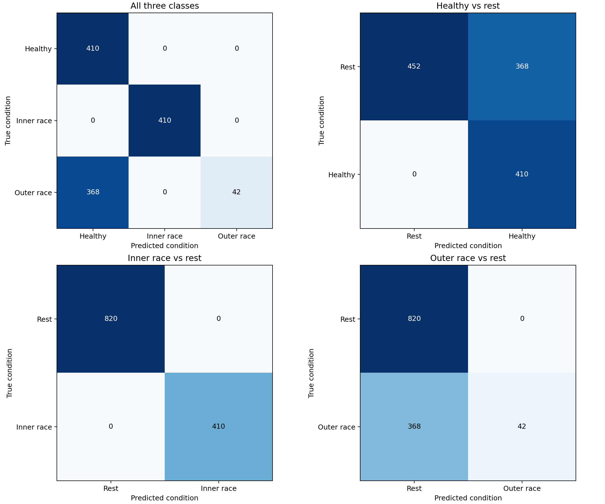

# Bearing CNN

[English](#run) · [中文](#中文)

Two-layer PyTorch 1D CNN for healthy, inner-race and outer-race bearing signals. Reads only the first CSV column, using **1,024 samples per segment** and **batch size 32**.

## Run

Python 3.10+ is required. The reference run used Python 3.13.9 on CPU.

```bash
python3 -m venv .venv
source .venv/bin/activate
python -m pip install -r requirements.txt
python bearing_fault_cnn.py --data-dir data --output-dir runs/baseline
```

Windows activation: `.venv\Scripts\activate`. In VS Code select `.venv` with **Python: Select Interpreter**. Use `python -m pip` so packages install into that interpreter. See [environment and Colab notes](docs/environment.md).

Supply your own authorized CSVs in `data/`. **Raw recordings and lecture materials are not distributed.** The public repository contains source, instructions, synthetic tests and aggregate results only. The dataset's original source, sampling frequency and redistribution license have not been established here.

| Split | Healthy | Inner race | Outer race |
|---|---|---|---|
| Train | H_1_0.csv | I_1_2.csv | O_6_2.csv |
| Validation | H_3_0.csv | I_3_2.csv | O_7_2.csv |
| Test | H_4_0.csv | I_4_2.csv | O_8_2.csv |

Each reference file has 420,000 signal rows: **410 non-overlapping segments**, with 160 trailing samples discarded. Training and validation contain 1,230 segments each. Entire recordings stay in one split. Independence of physical bearings across recordings has not been established.

The loader accepts numeric strings and an optional first-row header, and rejects missing or non-finite samples. Only training signals determine the global mean and standard deviation. The two convolution layers use 32 and 64 filters. Validation loss selects the checkpoint; early stopping uses patience 10 with at most 50 epochs. The test set is evaluated after model selection.

## Reference results

| Test condition | Correct / total | Recall |
|---|---:|---:|
| Healthy | 410 / 410 | 100.00% |
| Inner race | 410 / 410 | 100.00% |
| Outer race | 42 / 410 | 10.24% |
| Overall accuracy | 862 / 1,230 | 70.08% |

Epoch 13 was restored after stopping at epoch 23. Its validation accuracy was 98.94%. The model missed 368 outer-race segments, classifying them as healthy. This is a baseline experiment with a substantial failure on the held-out outer-race recording, not a validated diagnostic system. A repeated local CPU run produced the same reported result; that is reproducibility, not new independent evidence.



[Aggregate metrics](results/summary.json) · [Pipeline walkthrough](docs/workflow.md) · [Learning articles](https://github.com/Tooonnnnyyy/knowledge-base/tree/content/bearing-cnn/content/posts)

Local runs generate model weights, normalization parameters, metrics, predictions and figures. Keep these under ignored `runs/`. Use a new `--output-dir` per experiment to avoid overwriting evidence. The script is byte-identical to the reference training script; its SHA-256 is recorded in the summary.

## Checks

```bash
python -m unittest discover -s tests -v
```

CI checks parsing, recording separation, tensor dimensions, gradient updates, metrics and synthetic end-to-end execution. CI does **not** reproduce the private-recording accuracy experiment.

## 中文

这是一个轴承状态分类基准：健康、内圈故障、外圈故障。只使用 CSV 第一列；每段 1,024 个样本，批大小 32，模型包含两个一维卷积层。

先创建虚拟环境、安装 `requirements.txt`，将有权使用的九个 CSV 放入 `data/`，再运行上方命令。训练、验证和测试按完整文件分开，标准化统计量只从训练集计算。数据、课件、模型权重和逐样本预测均未公开。

本轮总体准确率 70.08%；健康与内圈召回率均为 100%，外圈仅 10.24%。外圈 410 段中有 368 段被判断为健康。相同环境重复运行得到一致结果，并不证明新设备或其他工况也能识别良好。

本机 CPU 已能完成该实验。Colab 的 GPU 可用于较大的实验，但更换算力不会自动修正数据覆盖或泛化问题。
