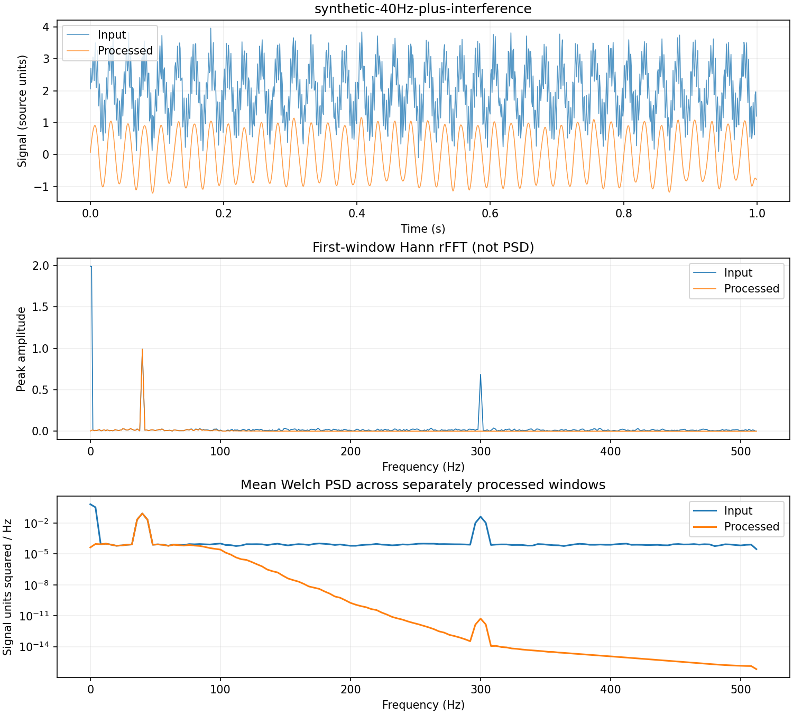

# Signal experiments

[English](#setup) · [中文](#中文)

These optional tools preserve `bearing_fault_cnn.py` and its reference result. They add preprocessing, frequency diagnostics, recording-level splits and transfer learning. No method is assumed to improve the 10.24% outer-race test recall.

## Setup

```bash
python -m pip install -r requirements-experiments.txt
python -m unittest discover -s tests -v
python learning_scale.py
```

SciPy supplies detrending, stable second-order-section Butterworth filters and Welch spectra. Scikit-learn supplies reproducible split algorithms. The original requirements remain sufficient for the reference script.

## Inspect before filtering

```bash
python signal_diagnostics.py --demo --output-dir runs/synthetic-diagnostics
python signal_diagnostics.py --data-dir data --split train --detrend constant --output-dir runs/train-diagnostics
```

The demo has a **known synthetic 1,024 Hz rate**, a 40 Hz useful tone, 300 Hz interference, Gaussian noise and a DC offset. It demonstrates a low-pass filter under those assumptions; its settings must not be copied onto unknown bearing data.

Private-data diagnostics inspect only train or validation recordings. Without `--sample-rate`, axes use samples and cycles/sample. With a verified rate, `--sample-rate FS` enables Hz. Replace `FS` with the acquisition rate. Do not infer it from 420,000 rows.

Optional processing flags:

| Flag | Operation | Main risk |
|---|---|---|
| `--detrend constant` | Remove each window's mean | Removes offset information |
| `--detrend linear` | Remove fitted linear trend within each window | Can remove real slow variation |
| `--high-hz F` | Low-pass below a documented edge | Can remove fault impulses/high-frequency resonance |
| `--low-hz F` | High-pass above an edge | Can remove useful slow behavior |
| Both edges | Band-pass | Needs a physically justified band |
| `--notch-hz F --notch-q Q` | Suppress identified narrow interference | Can suppress a real fault component too |

All Hz filters require `0 < edge < fs/2`. Butterworth uses order 4 by default. Forward-backward application squares magnitude response and doubles effective order: the single-pass cutoff is not the combined -3 dB point. Filtering is window-local, with edge padding and possible transients; it never reads another partition. It is an offline complete-window design, not causal streaming inference. Do not filter a complete timeline before splitting it.

`amplitude_spectrum` uses a Hann taper, coherent-gain correction and correct one-sided scaling: DC and Nyquist are not doubled. A 1,024-point real FFT produces **513 bins**, including DC/Nyquist. A taper reduces leakage but widens peaks; FFT is a representation, not a denoiser. Welch averages windowed periodograms; smoothing an estimate does not clean the original waveform.

## Compare development runs

```bash
python train_experiment.py --data-dir data --output-dir runs/dev-raw
python train_experiment.py --data-dir data --detrend constant --output-dir runs/dev-demean
python train_experiment.py --data-dir data --detrend constant --representation log-spectrum --output-dir runs/dev-spectrum
```

Each new directory holds a checkpoint, configuration, source hashes, epoch history and validation metrics. The time path uses 1,024 samples; the spectral path uses 513 `log1p(amplitude)` values. The same two-convolution architecture accepts either via adaptive pooling, but convolutions then operate over different axes. They are distinct experiments and their pretrained weights are not interchangeable. The Fourier phase is discarded by the spectral path.

By default **test files are not read**. Select preprocessing/learning settings on development data. `--evaluate-test` opts into test evaluation after the choice is fixed; it reruns training with the supplied configuration and seed, so retain those exact values. Existing H4/I4/O8 errors are already known: any choice informed by them needs new independent recordings for a fresh final generalization claim.

The training scaler is fitted after preprocessing/representation. Transfer runs instead reuse the saved source scaler. No clipping or interpolation repairs are silently applied. If a real signal is saturated or missing, first investigate acquisition; filtering cannot recover absent information.

### Measured development comparison

Three local CPU runs used the fixed train/validation recordings, seed 42, batch 32, Adam 0.001, maximum 50 epochs and patience 10. Each restored minimum validation cross-entropy. No new test evaluation was performed.

| Input | Selected epoch | Validation accuracy | Recall H / I / O | Macro F1 |
|---|---:|---:|---|---:|
| Raw time | 13 | 98.94% | 100 / 100 / 96.83% | 98.94% |
| Mean-removed time | 1 | 66.67% | 100 / 0 / 100% | 55.56% |
| Mean-removed log amplitude spectrum | 21 | 97.40% | 100 / 99.51 / 92.68% | 97.38% |

[Aggregate development evidence](../results/development-comparison.json) preserves configuration and confusion counts. The mean-removed run later reached higher accuracy, but its validation loss did not beat epoch 1; changing the rule afterward would be a different experiment. These results do not establish that an offset is a true fault feature or that FFT improves generalization. They show that plausible preprocessing can hurt and that loss and accuracy answer different questions. Independent identities and acquisition metadata remain unknown.



This figure uses generated tones and noise only. It is not a plot of the private bearing recordings. Real training diagnostics remain local.

## Recording-level split manifests

Store private metadata under `data/metadata.json`, a list of records:

```json
[
  {"file":"example.csv","label":0,"group":"bearing-A","domain":"load-low","time":1}
]
```

This one-record illustration is not enough to train. `label` is 0 healthy, 1 inner, 2 outer; `group` is a real bearing identity, `domain` a known acquisition condition, and `time` a sortable recording order. If only recording identity is known, use it as the group and explicitly limit the claim to unseen recordings.

```bash
python data_splits.py --metadata data/metadata.json --method stratified-group --folds 3 --output runs/splits/grouped.json
python data_splits.py --metadata data/metadata.json --method cross-domain --validation-domain load-mid --test-domain load-high --output runs/splits/domains.json
python train_experiment.py --data-dir data --split-manifest runs/splits/grouped.json --output-dir runs/grouped-model
```

Supported methods: `random`, `stratified`, `group`, `stratified-group`, `temporal`, `cross-domain`. Every output is recording-level; no option randomly mixes adjacent windows. `stratified-group` assigns one fold to test, the next to validation, and the remaining folds to training; its proportions follow `--folds`, not size flags. Group stratification approximates class balance and can be impossible. Missing classes cause a clear failure instead of misleading accuracy.

`group` proportions concern group counts, not exact rows/windows. `temporal --gap-records N` removes N complete recordings at each boundary; it is not a sample-level purge for overlapping windows. Temporal splits can reuse a physical machine when the claim is future observations of that same fleet; inspect the reported overlap. Cross-domain assigns the named target condition to test and a different condition to validation. It reports physical-group overlap separately. Leave-one-domain-out requires repeating this across target domains and reporting every result, not only the best.

## Transfer learning

Use a trusted local source checkpoint with the same ordered three classes, input length and preprocessing. A source can be a separately trained `train_experiment.py` checkpoint. Target validation/test files and any known physical groups must be absent from source training/validation, including recorded ancestors. File names alone cannot detect renamed duplicates; acquisition identity and source data provenance remain a manual gate.

```bash
python train_experiment.py --data-dir data --split-manifest runs/splits/target.json --pretrained runs/source/model.pt --freeze-backbone --unfreeze-after 5 --learning-rate 0.001 --output-dir runs/transfer
```

The first five epochs train the dense classifier; then all layers unfreeze and a fresh Adam optimizer uses 0.0001. Validation chooses the best checkpoint across both phases. `--freeze-backbone` alone trains only dense layers; omitting it fine-tunes all layers immediately. Architecture and source input scale are preserved. The example does not swap labels or replace the head for a new class task.

Compare a target-only scratch run with head-only and fine-tuned runs using identical target train/validation budgets and metrics. More target labels or source data is additional evidence, not a free improvement. A negative transfer result is valid. The current reference checkpoint shares the original validation recording with that same split, so it is intentionally rejected as a “new independent” transfer experiment on the unchanged split.

No pretrained checkpoint is shipped publicly. Transformer/LLM weights cannot be loaded into this small Conv1d architecture. This code demonstrates weight transfer for compatible signal models, not GPT/Claude fine-tuning.

## 中文

先安装扩展依赖，再按“诊断 → 提出一个处理假设 → 训练／验证对比 → 冻结方案 → 独立测试”执行。原脚本和 70.08% 基准结果保持原样；新实验默认不读测试文件，输出目录已存在就拒绝覆盖。

降噪不是把曲线画平滑：故障冲击可能正是需要保留的高频信息。采样率未知时只能画 cycles/sample，不能猜 Hz 截止频率。FFT 将时间信号变成复数频率成分；幅度谱去掉相位，Hann 减少谱泄漏，Welch 减少谱估计波动，这几件事并不相同。

划分单位首先应符合部署问题。分层保持类别比例，分组隔离设备／记录，时间划分测试未来，跨域划分测试未见工况；分层不能替代防泄漏。代码读取真实 metadata，不把文件编号冒充转速、负载或设备身份。

迁移学习需要可追溯的 source checkpoint 和有标签的目标训练数据。先冻结卷积特征层训练分类器，再用更小学习率解冻；与目标数据从零训练对比。源模型的训练／选模数据如果碰到目标验证或测试，就无法支持独立迁移结论。原始信号、局部图表、划分清单和 checkpoint 都保存在忽略目录，不随公共仓库上传。
